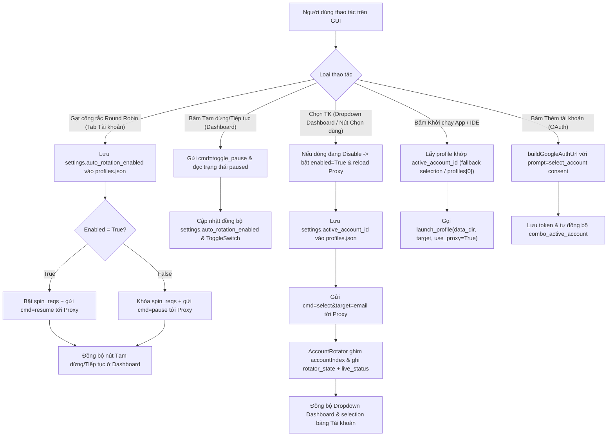

# Task Plan: Tắt/Bật Round Robin & Đổi Tài khoản Đăng nhập trên UI App (Option 2)

## 0. Metadata

| Field | Value |
| :--- | :--- |
| **Task ID** | `TASK-20261119-001` |
| **Ngày tạo** | 2026-11-19 |
| **Người tạo** | JARVIS |
| **Priority** | 🟠 High |
| **Effort** | M (1.5-2.5h) |
| **Status** | ✅ Done |
| **Branch** | `feature/toggle-round-robin-account-switch` |
| **Lifecycle** | `Done` |
| **Evidence** | `Confirmed` |
| **Plan structure** | Modular |
| **Project root** | `d:\1_Project\85_antigravity-hub` |
| **Plan path** | `planning/tasks/20261119_toggle_round_robin_switch_account/TASK_TOGGLE_ROUND_ROBIN_SWITCH_ACCOUNT.md` |
| **Change intent key** | `option2-toggle-round-robin-and-switch-active-account-ui` |

---

## 1. Mục tiêu & giá trị

Triển khai **Option 2** (gọn nhẹ, tối ưu để mở Pull Request lên repository tác giả `JunMystery/antigravity-hub`):
- Bổ sung công tắc `ToggleSwitch` tắt/bật xoay vòng **Round Robin** ngay trên thanh đáy tab **Tài khoản**, đồng bộ 2 chiều với nút `Tạm dừng` / `Tiếp tục` ở **Dashboard** và lưu bền vững qua `profiles.json` / `rotator_state.json`.
- Bổ sung **Dropdown chọn đích danh tài khoản đang dùng** ngay trên **Dashboard** (kèm nút **Chọn dùng** ở Action Bar tab **Tài khoản**), lệnh `cmd=select` ở Micro-Proxy, đồng bộ tài khoản active với profile khởi chạy (`--user-data-dir`), và cập nhật OAuth `prompt=select_account consent` để luôn bật hộp chọn tài khoản Google khi đăng nhập thêm/lại.
- **Giá trị đo được**: Giữ tối đa **Prompt Cache** khi tắt xoay vòng, chuyển đích danh tài khoản với 1 thao tác (không cần bấm `Kế tiếp` dò từng lượt), và đảm bảo Launch App/IDE mở đúng profile tài khoản đã chọn.

---

## 2. Phạm vi

- **In scope**:
  - Công tắc `ToggleSwitch` bật/tắt tự động xoay vòng Round Robin tại `AccountsView` (`settings.auto_rotation_enabled`), tự động khóa `spin_reqs` khi tắt xoay vòng, đồng bộ 2 chiều với `DashboardView` và `AccountRotator`.
  - Dropdown `combo_active_account` trên `DashboardView` + nút `btn_use_account` trên `AccountsView` (lưu `settings.active_account_id`, gửi `cmd=select&target=<email_or_id>` tới Proxy, và dùng đúng `data_dir` khi `_launch_target` từ Dashboard hoặc System Tray).
  - Nâng cấp `AccountRotator` (hỗ trợ `selectAccount`, bảo toàn tài khoản đang ghim qua chu kỳ `loadState()` 5s, đồng bộ `auto_rotation_enabled` không gây race condition).
  - Cập nhật `buildGoogleAuthUrl` trong `proxy/oauth_flow.js` dùng `prompt: "select_account consent"`.
  - Tách style QSS vào `launcher/launcher_theme.py`, bổ sung i18n VI/EN và bộ unit test tự động Node.js + PyQt6 headless.
- **Out of scope**:
  - Chế độ Direct Mode tắt hẳn Proxy trên GUI (`--no-proxy` vẫn dùng qua CLI hiện có).
  - Xóa/can thiệp thủ công dữ liệu phiên nội bộ bên trong thư mục `--user-data-dir/Antigravity`.
  - Sửa đổi payload AI chat trong `proxy/chat_payload_helper.js` (giữ nguyên Zero-Mutation Pass-Through).
  - Thay đổi số cột của bảng tài khoản (bắt buộc giữ nguyên 6 cột).
- **Affected users/environments**: Người dùng Windows & Linux (PyQt6 GUI, Node.js Micro-Proxy Port 20130, tương thích CLI & Backup/Restore `.zip`).
- **Data/contracts unchanged**:
  - Giữ nguyên key `settings.round_robin_enabled` cho tính năng Auto Refresh Quota mỗi 5 phút (`self.auto_refresh_enabled`).
  - Giữ nguyên cấu trúc `accounts.json`, `backup_manifest.json` và 6 cột của `AccountsView.treeview`.
  - Giữ nguyên contract các command Proxy cũ (`reload`, `next`, `pause`, `resume`, `toggle_pause`).

---

## 3. Hiện trạng / Nguyên lý / Assumptions / Constraints

### Confirmed (Đã xác minh trực tiếp từ mã nguồn)
1. **Bẫy tên key cũ `round_robin_enabled`**: Trong `launcher/launcher_storage.py` (dòng 47, 61, 79) và `launcher/launcher_window.py` (dòng 52, 157), `settings["round_robin_enabled"]` thực chất điều khiển `self.auto_refresh_enabled` (nút `Auto: ON/OFF` tự quét Quota 5 phút) — Proxy không sử dụng key này. Bắt buộc dùng key mới `settings["auto_rotation_enabled"]` cho tắt/bật xoay vòng.
2. **Tab Tài khoản thiếu điều khiển tắt Round Robin**: `launcher/launcher_view_accounts.py` (dòng 75) chỉ hiển thị nhãn tĩnh `rr_info` (`opt.mode`), chưa có công tắc bật/tắt xoay vòng.
3. **Launch phụ thuộc selection bảng ẩn**: `launcher/launcher_window.py` (`_launch_target`, dòng 214–217) gọi `self._get_selected()` trên bảng của tab Tài khoản đang bị ẩn khi user đứng ở Dashboard, fallback `profiles[0]`.
4. **Proxy thiếu lệnh chọn đích danh tài khoản & ánh xạ `id` khác nhau giữa 2 file JSON**:
   - `proxy/index.js` (dòng 203–228) và `launcher/launcher_monitor.py` (dòng 22–39) chỉ truyền/đọc `cmd` dạng chuỗi đơn.
   - `proxy/oauth_flow.js` (dòng 96, 130) lưu `accounts.json` với `id = UUID` còn `profiles.json` với `id = safeSlug`, hai file liên kết chéo tin cậy qua `email`. Do đó lệnh `select` và `loadState()` phải đối chiếu theo cả `id` và `email` (tra từ `profiles` nếu cần).
   - `proxy/account_rotator.js` (`loadState`, dòng 159–230) chạy mỗi 5s chỉ clamp `this.accountIndex % this.accounts.length`, có thể nhảy sai tài khoản khi user reorder hoặc bật/tắt Active.
5. **OAuth chưa ép hiển thị trình chọn tài khoản**: `proxy/oauth_flow.js` (dòng 31) đang đặt `prompt: "consent"`.
6. **Baseline tests & pitfall môi trường**:
   - `python -m unittest discover -s tests -p "test_proxy_rotation.py"` đã chạy thực tế: **7/7 PASS**.
   - `tests/test_view_navigation.py` (dòng 101) assert cứng `columnCount() == 6` và assert text/objectName của `btn_launch_app`, `btn_launch_ide`, `btn_next`, `btn_toggle_proxy`.
   - Chạy `test_view_navigation.py` trực tiếp với `%APPDATA%\antigravity-launcher\profiles.json` thật có `hide_on_launch="ask"` bị treo tại modal `launcher_prompt_dialog.py:71` khi `QTimer.singleShot(50, handle_hide_on_launch)` kích hoạt. Test mới bắt buộc cô lập `CONFIG_DIR` tạm và mock `handle_hide_on_launch` + `ensure_proxy_running`.

### Expected / To verify
- `tests/test_account_mode_switch.py` chưa tồn tại (`Expected`), sẽ được tạo mới ở Phase `P03`.
- Sơ đồ Mermaid ở Section 5 ở trạng thái `To verify` do chưa chạy trình render trực quan trong môi trường terminal.

### Assumptions
- Khi tắt Round Robin (`auto_rotation_enabled = False`, tương ứng `rotationPaused = True` trên Proxy), Proxy ghim tài khoản đang chọn cho mọi request thông thường, vẫn tự động failover nếu gặp lỗi `429`/`403`/`401` hoặc chuyển tức thì khi người dùng chọn tài khoản mới từ UI.
- Khi người dùng bấm **Chọn dùng** trên một dòng đang tắt cột `Active` (`enabled = False`), UI tự động bật `enabled = True` cho dòng đó và reload Proxy trước khi gửi lệnh `select` để đảm bảo Proxy nhận diện được tài khoản.

### Constraints & Non-goals
- **Quy tắc sạch PR upstream**: `.gitignore` hiện chưa ignore `planning/`. Khi commit để push branch lên mở PR với tác giả, **KHÔNG** stage/commit thư mục `planning/`; chỉ commit code trong `proxy/`, `launcher/`, `tests/`.
- **Rule 22 (UI Styling)**: Không viết inline style mới trong các View; đưa toàn bộ QSS vào `launcher/launcher_theme.py`.
- **Non-goals**: Không sửa đổi luồng CLI `--no-proxy`, không thay đổi logic xoay vòng Subagent hiện hành trong `chat_handler.js`.

---

## 4. File Impact & Ma trận Bán kính Ảnh hưởng (Blast Radius Matrix)

### Ma trận 4 tầng
- **Tầng 1 (Điểm sửa chính)**:
  - `proxy/account_rotator.js` (`selectAccount`, `loadState`, `handleCommand`)
  - `proxy/index.js` (`checkCmdFile`, `/_proxy_action`)
  - `proxy/oauth_flow.js` (`buildGoogleAuthUrl`)
  - `launcher/launcher_view_accounts.py` (`btn_use_account`, `toggle_round_robin`)
  - `launcher/launcher_view_dashboard.py` (`combo_active_account`, `update_dashboard`)
  - `launcher/launcher_window.py` (`on_toggle_round_robin`, `on_toggle_proxy_btn`, `on_select_active_account`, `on_use_selected_account`, `on_dashboard_account_changed`, `_sync_active_account_ui`, `_launch_target`)
- **Tầng 2 (Upstream Callers)**:
  - `launcher/launcher_monitor.py` (`send_proxy_cmd` mở rộng tham số `params`)
  - `launcher/launcher_oauth.py` (`start_google_oauth_flow` đồng bộ active selector sau khi login)
  - `launcher/launcher_tray.py` (menu Tray gọi `win.on_launch_app_clicked` / `win.on_launch_ide_clicked` thừa hưởng `active_account_id`)
- **Tầng 3 (Downstream Dependents)**:
  - `launcher/launcher_storage.py` (`load_data` thêm default `auto_rotation_enabled` & `active_account_id`)
  - `launcher/launcher_theme.py` (QSS cho `#combo_active_account`, `#btn_use_account`, `#lbl_active_acc`)
  - `launcher/locales/vi.json`, `launcher/locales/en.json`, `launcher/launcher_i18n.py` (khóa dịch VI/EN và fallback)
- **Tầng 4 (Side-Effects / State)**:
  - `profiles.json` (`settings.auto_rotation_enabled`, `settings.active_account_id`)
  - `rotator_state.json` (`rotation_paused`, `last_account_id`, `last_account_email`, `current_req_served`)
  - `live_status.json` (`account_email`, `paused`, `status`, `endpoint: "manual_select"`)
  - `proxy_cmd.json` (bổ sung trường `target` khi fallback file)
  - Đồng bộ 2 chiều: `DashboardView.btn_toggle_proxy` (`Tạm dừng` / `Tiếp tục`) ↔ `AccountsView.toggle_round_robin` ↔ `AccountRotator.rotationPaused`.

### Bảng File Impact bắt buộc

| Action | File path | Symbol/area | Reason | Evidence | Owner phase |
| :--- | :--- | :--- | :--- | :--- | :--- |
| Edit | `proxy/account_rotator.js` | `AccountRotator`, `loadState`, `selectAccount`, `handleCommand` | Thêm chọn đích danh TK (`select`), bảo toàn TK qua chu kỳ reload 5s, đồng bộ `auto_rotation_enabled` không race condition | `Confirmed` | `P01` |
| Edit | `proxy/index.js` | `checkCmdFile`, `/_proxy_action` | Truyền tham số `target` (query param & `proxy_cmd.json`) vào `rotator.handleCommand` | `Confirmed` | `P01` |
| Edit | `proxy/oauth_flow.js` | `buildGoogleAuthUrl` | Đổi `prompt: "consent"` → `"select_account consent"` để hiện màn hình chọn tài khoản Google | `Confirmed` | `P01` |
| Edit | `launcher/launcher_storage.py` | `load_data` | Thêm default `auto_rotation_enabled: True` và `active_account_id: ""`; giữ nguyên `round_robin_enabled` | `Confirmed` | `P02` |
| Edit | `launcher/launcher_monitor.py` | `send_proxy_cmd` | Mở rộng nhận `params: dict` (mã hóa query string & ghi payload vào `CMD_FILE`) | `Confirmed` | `P02` |
| Edit | `launcher/launcher_view_accounts.py` | `AccountsView`, `retranslate_ui` | Thêm nút `btn_use_account` (Action Bar) và `ToggleSwitch` `toggle_round_robin` (Bottom Bar), giữ nguyên 6 cột | `Confirmed` | `P02` |
| Edit | `launcher/launcher_view_dashboard.py` | `DashboardView`, `update_dashboard`, `retranslate_ui` | Thêm dropdown `combo_active_account` chọn nhanh TK đang dùng và đồng bộ với `live_status.json` | `Confirmed` | `P02` |
| Edit | `launcher/launcher_window.py` | `LauncherWindow` | Thêm handler bật/tắt Round Robin, chọn TK active, đồng bộ 2 chiều Dashboard↔Accounts và sửa `_launch_target` | `Confirmed` | `P02` |
| Edit | `launcher/launcher_oauth.py` | `start_google_oauth_flow` | Cập nhật selector tài khoản active sau khi thêm tài khoản Google mới thành công | `Confirmed` | `P02` |
| Edit | `launcher/launcher_theme.py` | `LAUNCHER_QSS` | Định nghĩa QSS tách riêng cho `#combo_active_account`, `#btn_use_account`, `#lbl_active_acc` | `Confirmed` | `P02` |
| Edit | `launcher/locales/vi.json` | i18n VI | Thêm nhãn/tooltip tiếng Việt cho toggle Round Robin, nút Chọn dùng và dropdown Dashboard | `Confirmed` | `P02` |
| Edit | `launcher/locales/en.json` | i18n EN | Thêm nhãn/tooltip tiếng Anh tương ứng | `Confirmed` | `P02` |
| Edit | `launcher/launcher_i18n.py` | `_FALLBACK_DEFAULTS` | Thêm bản dịch fallback cho các khóa mới | `Confirmed` | `P02` |
| Edit | `tests/test_proxy_rotation.py` | `TestProxyRoundRobinRotation` | Bổ sung unit test cho `selectAccount`, `handleCommand("select")`, giữ TK sau `loadState()` và OAuth `select_account` | `Confirmed` | `P03` |
| Create | `tests/test_account_mode_switch.py` | `TestAccountModeAndSwitcher` | Tạo test PyQt6 headless kiểm thử toggle Round Robin 2 chiều, dropdown/nút chọn TK, `_launch_target`, i18n và regression 6 cột | `Confirmed` | `P03` |

---

## 5. Luồng

> Trạng thái renderer: `To verify` (chưa xác minh render trực quan). Có fallback ASCII tương đương bên dưới.



### Fallback ASCII
```text
[Tab Tài khoản: Toggle Round Robin] --> lưu auto_rotation_enabled --> (resume/pause Proxy) <==> [Dashboard: Tạm dừng/Tiếp tục]
[Dashboard: Dropdown TK / Tab TK: Chọn dùng] --> (auto enable nếu cần) --> lưu active_account_id --> cmd=select --> [Proxy ghim TK]
[Khởi chạy App/IDE hoặc Tray] --> đọc active_account_id (fallback selection/profiles[0]) --> launch_profile(data_dir)
[Thêm tài khoản OAuth] --> prompt="select_account consent" --> mở hộp chọn Google --> cập nhật UI & selector
```

---

## 6. Phases & Tasks (Phase Index & Execution Roadmap)

| Phase | Name | Depends on | Files count | Tasks count | Detail Path | Status |
| :--- | :--- | :--- | :--- | :--- | :--- | :--- |
| `P01` | Nâng cấp Micro-Proxy Node.js (Select Account, Fixed Mode & OAuth Select) | `None` | `3` | `4` | `phases/P01_PROXY_ROTATION_CONTROL_AND_SELECT.md` | ✅ Done |
| `P02` | Nâng cấp PyQt6 Launcher UI (Toggle Round Robin & Account Switcher) | `P01` | `10` | `6` | `phases/P02_LAUNCHER_UI_TOGGLE_AND_SWITCHER.md` | ✅ Done |
| `P03` | Kiểm thử tự động & Nghiệm thu Regression | `P01, P02` | `2` | `3` | `phases/P03_AUTOMATED_TESTS_AND_VERIFICATION.md` | ✅ Done |

---

## 7. Test Strategy + Mapping AC

- **Chiến lược**: Kết hợp kiểm thử unit Node.js (gọi qua `subprocess` trong `tests/test_proxy_rotation.py`), kiểm thử GUI PyQt6 headless offscreen với `CONFIG_DIR` tạm cô lập (`tests/test_account_mode_switch.py`), kiểm tra compile syntax Python (`py_compile`), và chạy lại suite regression hiện có (`test_backup.py`).

| Check ID | Type | Scope / Input | Expected result | Environment / Constraint | Maps AC |
| :--- | :--- | :--- | :--- | :--- | :--- |
| `T-001` | Unit (Node.js) | `AccountRotator` với `auto_rotation_enabled: false` (hoặc `cmd="pause"`), gọi `allocateAccountForRequest` 5 lần (`requestsPerAccount=1`) | Cả 5 request trả về cùng 1 tài khoản; không tự nhảy tài khoản kế tiếp | `python -m unittest discover -s tests -p "test_proxy_rotation.py"` | `AC-1` |
| `T-002` | Unit (Node.js) | `handleCommand("select", ..., { target: "user2@test.com" })` và target không tồn tại `"missing@test.com"` | Target hợp lệ trả `200`, chuyển `getCurrentAccount()` sang `user2@test.com`, `currentAccRequestsServed=0`, xóa `unhealthyUntil`; target sai trả `404` không đổi tài khoản | `tests/test_proxy_rotation.py` | `AC-2`, `AC-5` |
| `T-003` | Unit (Node.js) | Reorder `profiles.json` hoặc đổi `enabled` khi đang ghim `user2@test.com` rồi gọi `loadState()` | `getCurrentAccount()` vẫn giữ đúng `user2@test.com`, không bị nhảy index theo vị trí mảng cũ | `tests/test_proxy_rotation.py` | `AC-2` |
| `T-004` | Unit (Node.js) | Gọi `buildGoogleAuthUrl(...)` | URL chứa tham số `prompt=select_account+consent` | `tests/test_proxy_rotation.py` | `AC-4` |
| `T-005` | Unit (PyQt6 headless) | Gạt `toggle_round_robin` OFF ↔ ON và bấm `btn_toggle_proxy` trên Dashboard (mock Proxy) | `settings.auto_rotation_enabled` cập nhật chính xác; `spin_reqs` bị khóa khi OFF; `btn_toggle_proxy` & `toggle_round_robin` đồng bộ 2 chiều; `round_robin_enabled` (Auto Quota) giữ nguyên | `python -m unittest discover -s tests -p "test_account_mode_switch.py"` (cô lập temp config, mock dialog) | `AC-1`, `AC-6` |
| `T-006` | Unit (PyQt6 headless) | Chọn tài khoản qua `combo_active_account` (Dashboard) và `btn_use_account` (Tài khoản, gồm cả dòng đang disable); bấm Launch App/IDE | Lưu `settings.active_account_id`; gọi `send_proxy_cmd("select", {"target": ...})`; tự bật `enabled=True` + `reload` nếu dòng bị tắt; `launch_profile` nhận đúng `data_dir` của tài khoản đã chọn | `tests/test_account_mode_switch.py` | `AC-2`, `AC-3`, `AC-5` |
| `T-007` | Regression & Static | Kiểm tra `columnCount() == 6`, chuyển ngôn ngữ `retranslate_ui()` EN ↔ VI, `py_compile`, và chạy `test_backup.py` | 100% pass; không lỗi syntax; không breaking change Backup/Restore | `tests/test_account_mode_switch.py` + `tests/test_backup.py` | `AC-6`, `AC-7` |

---

## 8. Risks / Rollback

| Risk | Likelihood | Impact | Mitigation | Detection | Owner |
| :--- | :--- | :--- | :--- | :--- | :--- |
| Nhầm `settings.round_robin_enabled` (Auto Refresh Quota) gây tắt nhầm Auto Quota | Medium | High | Tách riêng key `settings.auto_rotation_enabled`; giữ nguyên `round_robin_enabled` cho `self.auto_refresh_enabled` | `T-005` kiểm tra toggle Auto Quota độc lập với toggle Round Robin | Dev |
| Race condition giữa chu kỳ `loadState()` 5s và nút `Tạm dừng` / `Kế tiếp` | Medium | High | Chỉ áp dụng `cfg.settings.auto_rotation_enabled` / `active_account_id` trong `loadState()` khi giá trị trên đĩa thực sự thay đổi so với snapshot lần đọc trước | `T-003` và `T-005` | Dev |
| Sai khác `id` giữa `accounts.json` (UUID) và `profiles.json` (`safeSlug`) khi Proxy resolve `active_account_id` | High | High | UI gửi `email` làm `target` ưu tiên; Proxy tra chéo `profiles.json` từ `active_account_id` sang `email` và match cả `id` lẫn `email` | `T-002` và `T-003` | Dev |
| Vỡ test cũ `test_view_navigation.py` do thêm cột vào bảng hoặc đổi objectName nút cũ | Low | Medium | Giữ nguyên bảng 6 cột và giữ nguyên toàn bộ `objectName`/text của các widget hiện có | `T-007` assert `columnCount() == 6` | Dev |
| Lọt thư mục `planning/` vào commit mở PR cho tác giả | Medium | Medium | Quy định rõ trong DoD chỉ `git add proxy/ launcher/ tests/` khi tạo commit PR | Kiểm tra `git status` & `git diff --cached --name-only` ở `P03.3` | Dev |

### Quy trình Rollback
- **Trigger**: Thất bại trên bất kỳ test rotation/failover nào ở `proxy/`, lỗi crash UI PyQt6 khi khởi chạy, hoặc xung đột dữ liệu `profiles.json`.
- **Thao tác**:
  1. Hoàn tác code theo phase hoặc toàn bộ bằng `git checkout -- proxy/ launcher/ tests/` (hoặc `git checkout main` nếu hủy toàn nhánh).
  2. Do `profiles.json` chỉ bổ sung key mới (`auto_rotation_enabled`, `active_account_id`) có fallback mặc định, dữ liệu người dùng hiện hữu không cần migrate ngược.

---

## 9. Acceptance Criteria

- [x] `AC-1`: Trên tab **Tài khoản**, người dùng gạt được công tắc **Tự động xoay vòng (Round Robin)** để tắt/bật xoay vòng; trạng thái này khóa/mở `Req / acc`, đồng bộ 2 chiều với nút `Tạm dừng` / `Tiếp tục` ở **Dashboard**, và giữ nguyên hiệu lực sau khi Proxy reload/restart. *(Maps `T-001`, `T-005`)*
- [x] `AC-2`: Người dùng chọn đích danh tài khoản đang dùng qua **Dropdown trên Dashboard** hoặc nút **Chọn dùng** trên tab **Tài khoản**; Proxy lập tức chuyển sang tài khoản đó (`cmd=select`), giữ đúng tài khoản qua chu kỳ `loadState()` 5s kể cả khi reorder bảng. *(Maps `T-002`, `T-003`, `T-006`)*
- [x] `AC-3`: Bấm **Khởi chạy App (2.0)** hoặc **Khởi chạy IDE** (từ Dashboard hoặc System Tray) luôn mở đúng `data_dir` tương ứng tài khoản đang chọn trong `active_account_id` (fallback selection bảng / phần tử đầu tiên). *(Maps `T-006`)*
- [x] `AC-4`: Luồng OAuth thêm tài khoản Google (`_oauth/start`) sinh URL có `prompt=select_account+consent` để người dùng dễ dàng chọn/đổi tài khoản Google trên trình duyệt, và tự cập nhật selector UI sau khi hoàn tất. *(Maps `T-004`)*
- [x] `AC-5`: Các trường hợp biên (chọn `target` không tồn tại trên Proxy, bấm `Chọn dùng` khi chưa chọn dòng hoặc khi danh sách trống, chọn dòng đang tắt `Active`) được xử lý an toàn, không crash UI hay Proxy. *(Maps `T-002`, `T-006`)*
- [x] `AC-6`: Bảng tài khoản giữ nguyên **6 cột**, nút `Auto: ON/OFF` (tự quét Quota 5 phút) hoạt động độc lập không bị ảnh hưởng, Backup/Restore `.zip` pass bình thường. *(Maps `T-005`, `T-007`)*
- [x] `AC-7`: Giao diện chuyển đổi song ngữ **Tiếng Việt ↔ English** đầy đủ cho mọi widget mới và không dùng inline style mới ngoài `launcher_theme.py`. *(Maps `T-007`)*

---

## 10. Definition of Ready / Definition of Done + Checklist

- **DoR**: Đã audit đủ 4 tầng Blast Radius, tạo nhánh git `feature/toggle-round-robin-account-switch`, chốt phạm vi Option 2 và định nghĩa rõ 7 AC kèm 7 Check ID map tương ứng.
- **DoD**: Toàn bộ Phase `P01`–`P03` đạt `Done`, tất cả check `T-001`–`T-007` pass, các gate (Security, Data, Accessibility, Compatibility) đạt chuẩn, và nhánh git sẵn sàng stage/commit sạch (`proxy/`, `launcher/`, `tests/`, loại trừ `planning/`) để push mở PR.

| Item | Status | Evidence / Owner |
| :--- | :--- | :--- |
| DoR complete | `Pass` | Đã tạo nhánh `feature/toggle-round-robin-account-switch` và chốt đủ Master Plan + 3 Phase files (`JARVIS`) |
| Required validation | `Pass` | `test_proxy_rotation.py` (11/11 OK), `test_account_mode_switch.py` (3/3 OK), `test_backup.py` (5/5 OK), cùng regression `test_proxy_hang_remediation.py` (8/8), `test_activity_logs.py` (9/9), `test_log_manager.py` (5/5) |
| Security / Data / Accessibility / Compatibility gates | `Pass` | Tất cả gate cấp Phase `P01`, `P02`, `P03` đều đạt `Passed` |
| DoD complete | `Pass` | 100% Phases (`P01`–`P03`), Tasks (13/13), và `AC-1`–`AC-7` hoàn thành |
